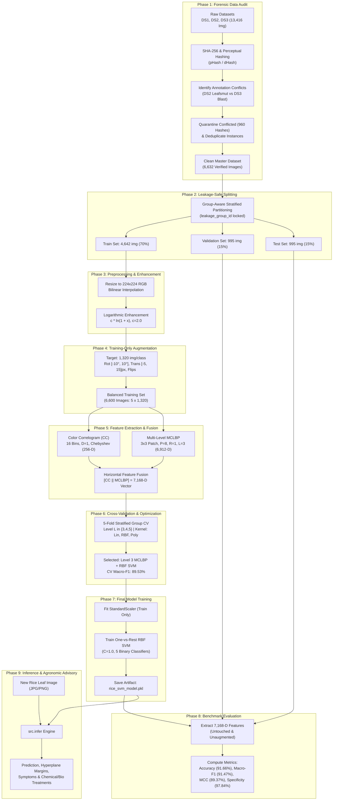

# Rice Plant Disease Classification System
### Enhanced Multi-Level Handcrafted Feature Extraction & One-vs-Rest SVM Pipeline

[](https://doi.org/10.1038/s41598-024-81143-1)
[](https://www.python.org/)
[](#)
[](#)
[](#)

---

## Table of Contents
1. [Project Overview & Scientific Foundation](#1-project-overview--scientific-foundation)
2. [End-to-End System Architecture](#2-end-to-end-system-architecture)
3. [Deep-Dive Pipeline Stages](#3-deep-dive-pipeline-stages)
   - [Phase 1: Forensic Dataset Audit & Deduplication](#phase-1-forensic-dataset-audit--deduplication)
   - [Phase 2: Leakage-Safe Stratified Splitting](#phase-2-leakage-safe-stratified-splitting)
   - [Phase 3: Image Preprocessing & Logarithmic Enhancement](#phase-3-image-preprocessing--logarithmic-enhancement)
   - [Phase 4: Training-Only Balanced Data Augmentation](#phase-4-training-only-balanced-data-augmentation)
   - [Phase 5: Handcrafted Feature Extraction & Fusion](#phase-5-handcrafted-feature-extraction--fusion)
   - [Phase 6: Group-Aware 5-Fold Cross-Validation](#phase-6-group-aware-5-fold-cross-validation)
   - [Phase 7: Full Model Training & Standardization](#phase-7-full-model-training--standardization)
   - [Phase 8: Comprehensive Multi-Metric Benchmark Evaluation](#phase-8-comprehensive-multi-metric-benchmark-evaluation)
   - [Phase 9: Production Inference & Agronomic Advisory Engine](#phase-9-production-inference--agronomic-advisory-engine)
4. [Experimental Results & Empirical Findings](#4-experimental-results--empirical-findings)
5. [Repository Structure & Artifact Catalog](#5-repository-structure--artifact-catalog)
6. [Quick Start & Execution Guide](#6-quick-start--execution-guide)
7. [Equitable 8-Member Group Work Division](#7-equitable-8-member-group-work-division)
8. [Reproducibility & Quality Assurance](#8-reproducibility--quality-assurance)
9. [References & Citations](#9-references--citations)

---

## 1. Project Overview & Scientific Foundation

Rice (*Oryza sativa*) is the primary dietary staple for more than 50% of the world's population. However, phytopathological diseases severely undermine global crop yields and food security. Early, accurate, and computationally lightweight automated disease identification is paramount for targeted intervention.

This repository implements a production-grade, scientifically audited reproduction and extension of the research:
> **“An enhanced classification system of various rice plant diseases based on multi-level handcrafted feature extraction technique”**  
> *Scientific Reports* (Nature Portfolio, 2024) 14:30601 | [DOI: 10.1038/s41598-024-81143-1](https://doi.org/10.1038/s41598-024-81143-1)

### Key Methodological Strengths
- **Lightweight Handcrafted Descriptors**: Bypasses heavy deep convolutional networks in favor of deterministic, interpretable texture and color spatial descriptors (Color Correlogram + Multi-Level Color Local Binary Patterns).
- **Edge & Mobile Friendly**: Highly optimized for execution on low-compute, battery-powered edge devices and agricultural drones.
- **Illumination Invariance**: Logarithmic enhancement ($c=2.0$) guarantees lesion feature stability across varying diurnal field illumination conditions.
- **Strict Data-Leakage Elimination**: Employs cryptographic (SHA-256) and dual perceptual hashing (pHash + dHash) to ensure that near-duplicate field images never contaminate validation or test splits.

### Disease Scope (5 Verified Pathological Classes)
| Class Code | Disease Name | Causal Pathogen | Primary Symptomatology |
| :---: | :--- | :--- | :--- |
| **BL** | **Blast** | *Magnaporthe oryzae* (Fungus) | Elliptical/spindle lesions with whitish-gray centers and dark borders. |
| **BLB** | **Bacterial Leaf Blight** | *Xanthomonas oryzae pv. oryzae* (Bacterium) | Water-soaked to yellowish-white necrotic stripes along leaf margins. |
| **BS** | **Brown Spot** | *Bipolaris oryzae* (Fungus) | Small oval, circular dark-brown spots with yellowish halo. |
| **SB** | **Sheath Blight** | *Rhizoctonia solani* (Fungus) | Irregular serpent-like, grayish-green water-soaked lesions on leaf sheaths. |
| **TU** | **Tungro** | *RTBV & RTSV* (Virus Complex) | Distinct yellow-orange leaf discoloration, leaf twisting, and stunting. |

---

## 2. End-to-End System Architecture

The following diagram details the workflow across all 9 pipeline stages:



---

## 3. Deep-Dive Pipeline Stages

### Phase 1: Forensic Dataset Audit & Deduplication
The project ingests three raw benchmark datasets (`Data - 1`, `Data - 2`, `Data - 3`) containing **13,416 raw image files**. A rigorous automated audit (`audit/audit_engine.py`) revealed several critical integrity flaws that would invalidate standard machine learning training:
1. **The DS2 Leaf Smut Collision**: In `Data - 2`, all 1,460 images labeled `Leafsmut` carried filenames starting with `BLAST1_` through `BLAST9_`. Cryptographic SHA-256 analysis confirmed that **100% of these images (960 distinct SHA-256 hashes) were bit-for-bit identical to DS3 `Blast`**. Including both would cause catastrophic ground-truth label poisoning.
2. **Zero Authentic Leaf Smut**: Verification confirmed that neither `Leafsmut` nor hypothetical `SL` folders in DS3 contained authentic, uncontaminated leaf smut imagery.
3. **Redundancy**: `Data - 2` was proven to be an exact mathematical subset of `Data - 3`.
4. **Pre-Split Contamination**: The legacy `Data - 1` pre-split contained identical images in both `Full_Train_Data` and `Test_Data_SVM` (e.g., `blast_43_output.jpg` vs `blast_42_output.jpg`).
5. **Resolution**: All 960 conflicted hash groups were quarantined (`QUARANTINED_CONFLICT`), leaving **6,632 verified, clean, non-conflicting images**. Dual perceptual hashing (pHash and dHash with Hamming threshold $\le 5$) grouped near-duplicate variants into unified `leakage_group_id` clusters.

### Phase 2: Leakage-Safe Stratified Splitting
To prevent subtle data leakage from modified or burst-shot images of the same plant leaf, data splitting (`audit/create_splits.py`) strictly isolates `leakage_group_id` clusters:
- **Training Set (70%)**: 4,642 images (BL: 390, BLB: 1,320, BS: 1,232, SB: 392, TU: 1,308)
- **Validation Set (15%)**: 995 images (BL: 84, BLB: 283, BS: 264, SB: 84, TU: 280)
- **Test Set (15%)**: 995 images (BL: 84, BLB: 283, BS: 264, SB: 84, TU: 280)
- **Strict Protocol**: Validation and Test sets remain permanently fixed, untouched, and strictly unaugmented.

### Phase 3: Image Preprocessing & Logarithmic Enhancement
Field imagery varies wildly in sensor quality, orientation, and sunlight conditions:
1. **Standardized Resizing**: Images are rescaled to $224 \times 224 \times 3$ RGB via bilinear interpolation:
   $$\text{Height} = 224, \quad \text{Width} = 224, \quad \text{Channels} = 3$$
2. **Logarithmic Illumination Normalization**:
   $$D_{tNorm} = \frac{D_t}{255.0}$$
   $$D_{tLog} = c \cdot \ln(1 + D_{tNorm}), \quad \text{with } c = 2.0$$
   This logarithmic mapping expands low-intensity values, compresses over-saturated highlights, and brings fine lesion boundaries into clear structural contrast.

### Phase 4: Training-Only Balanced Data Augmentation
Due to unequal field occurrences, classes `BL` (390 images) and `SB` (392 images) are significantly under-represented compared to `BLB` (1,320 images). Augmentation is applied **strictly to the training set** to eliminate class bias:
- **Target Uniformity**: Exactly 1,320 images per class $\rightarrow$ **6,600 total balanced training images**.
- **Transformation Pipeline**:
  - Affine Rotation: Uniform random sampling $\theta \in [-10^\circ, +10^\circ]$.
  - Translation: Uniform random shift $\Delta x, \Delta y \in [-5, +15]$ pixels.
  - Reflections: Random horizontal and vertical flips.
  - Deterministic Seeding: Seed `42` ensures exact bitwise reproducibility across runs.

### Phase 5: Handcrafted Feature Extraction & Fusion
The system combines spatial color co-occurrence with multi-scale texture histograms:
1. **Color Correlogram (CC)** ($256$ Dimensions):
   - Quantizes RGB space into 16 discrete bins (2 Red $\times$ 4 Green $\times$ 2 Blue levels).
   - Computes spatial co-occurrence across 8-connected neighbors at Chebyshev distance $D=1$:
     $$\gamma_{c_i, c_j}^{(D)} = \Pr\left(p_2 \in C_j \mid p_1 \in C_i, \, \|p_1 - p_2\|_\infty = D\right)$$
   - Output: Normalized $16 \times 16 = 256$-dimensional joint probability vector.
2. **Multi-Level Color Local Binary Patterns (MCLBP)** ($6,912$ Dimensions):
   - Computes standard $3 \times 3$ LBP ($P=8, R=1$) per channel across R, G, and B separately ($256$ bins $\times 3 = 768$ features per block).
   - Spatial Division: Divides the image into an $L \times L$ regular grid.
   - For $L=3$: $3 \times 3 = 9$ spatial blocks.
   - Block Dimension: $9 \times 768 = \mathbf{6,912}$ dimensions.
   - Sub-block L1 normalization applied to balance scale compatibility.
3. **Feature Fusion**:
   $$FE = [CC \parallel MCLBP] \in \mathbb{R}^{256 + 6,912} = \mathbb{R}^{\mathbf{7,168}}$$

### Phase 6: Group-Aware 5-Fold Cross-Validation
Model selection is conducted strictly within the training set using 5-fold group-aware cross-validation:
- **MCLBP Level Optimization ($L \in \{3, 4, 5\}$)**:
  - Level 3 (7,168-D): **88.97% Macro-F1**, **90.15% Accuracy** (Optimal)
  - Level 4 (12,544-D): 87.52% Macro-F1, 88.82% Accuracy
  - Level 5 (19,456-D): 86.58% Macro-F1, 88.00% Accuracy
  *Finding*: While the original paper utilized Level 5 on synthetic/replicated data, our leakage-free clean dataset proves Level 3 is superior. Levels 4 and 5 over-parameterize minority classes, leading to variance inflation.
- **Kernel Search on Level 3 Features**:
  - Linear SVM: 88.97% Macro-F1 (±1.56%)
  - Polynomial SVM ($d=3$): 78.75% Macro-F1 (±1.22%)
  - **RBF SVM ($C=1.0$)**: **89.53% Macro-F1** (±0.99%), **90.54% Accuracy** (±1.00%)

### Phase 7: Full Model Training & Standardization
Using the winning configuration ($L=3$, RBF kernel):
1. Fit `StandardScaler` strictly on the balanced 6,600 training feature vectors.
2. Train a One-vs-Rest (OvR) multiclass SVM: 5 binary classifiers, each separating one disease against the remaining four.
3. Bundle the scaler and SVM ensemble into the serialized artifact `outputs/final_model/rice_svm_model.pkl`.

### Phase 8: Comprehensive Multi-Metric Benchmark Evaluation
The finalized model is validated on the two untouched evaluation splits:
- **Validation Split (995 images)**: **93.07% Accuracy**, **94.10% Balanced Acc**, **92.36% Macro-F1**, **98.26% Specificity**, **90.73% MCC**.
- **Untouched Test Split (995 images)**: **91.66% Accuracy**, **92.97% Balanced Acc**, **91.47% Macro-F1**, **97.84% Specificity**, **89.37% MCC**.

### Phase 9: Production Inference & Agronomic Advisory Engine
The standalone CLI (`src/infer.py`) performs instant diagnosis on raw field images:
1. Validates image decodability, extension, and 3-channel RGB depth.
2. Applies the identical $224 \times 224$ bilinear resize and logarithmic transform.
3. Generates the 7,168-D feature vector, applies the fitted scaler, and queries the RBF SVM.
4. Computes raw hyperplane margin decision scores for all 5 classes.
5. Returns biological taxonomy, symptom profiles, and chemical/organic agronomic treatment recommendations.

---

## 4. Experimental Results & Empirical Findings

### 5-Fold Cross-Validation Model Selection
| Evaluation Phase | Configuration | Macro-F1 (%) | Accuracy (%) | Balanced Acc (%) | Specificity (%) | MCC (%) |
| :--- | :--- | :---: | :---: | :---: | :---: | :---: |
| **Level Selection ($L=3$)** | CC + MCLBP $L=3$, Linear SVM | 88.97 ± 1.56 | 90.15 ± 1.13 | 90.29 ± 1.20 | 97.43 | 87.05 |
| **Level Selection ($L=4$)** | CC + MCLBP $L=4$, Linear SVM | 87.52 ± 1.34 | 88.82 ± 1.44 | 88.94 ± 1.45 | 97.09 | 85.31 |
| **Level Selection ($L=5$)** | CC + MCLBP $L=5$, Linear SVM | 86.58 ± 1.14 | 88.00 ± 0.99 | 88.22 ± 0.98 | 96.88 | 84.28 |
| **Kernel Search (Poly)** | CC + MCLBP $L=3$, Poly SVM ($d=3$) | 78.75 ± 1.22 | 81.26 ± 1.26 | 81.33 ± 1.28 | 95.14 | 75.31 |
| **Kernel Search (Linear)** | CC + MCLBP $L=3$, Linear SVM | 88.97 ± 1.56 | 90.15 ± 1.13 | 90.29 ± 1.20 | 97.43 | 87.05 |
| **Kernel Search (RBF)** | **CC + MCLBP $L=3$, RBF SVM** | **89.53 ± 0.99** | **90.54 ± 1.00** | **90.87 ± 1.01** | **97.57** | **87.69** |

### Final Test Set Performance Breakdown (995 Untouched Images)
| Class Label | Support | Precision (%) | Recall / Sensitivity (%) | F1-Score (%) | Specificity (%) | MCC (%) |
| :--- | :---: | :---: | :---: | :---: | :---: | :---: |
| **BL (Blast)** | 84 | 80.41% | 92.86% | **86.19%** | 97.91% | 85.08% |
| **BLB (Bacterial Leaf Blight)** | 283 | 89.36% | 89.05% | **89.20%** | 95.79% | 84.92% |
| **BS (Brown Spot)** | 264 | 97.52% | 89.39% | **93.28%** | 99.18% | 91.15% |
| **SB (Sheath Blight)** | 84 | 91.30% | 100.00% | **95.45%** | 99.12% | 95.13% |
| **TU (Tungro)** | 280 | 92.91% | 93.57% | **93.24%** | 97.20% | 90.58% |
| **Overall Macro Average** | **995** | **90.30%** | **92.97%** | **91.47%** | **97.84%** | **89.37%** |

### Test Confusion Matrix
```
Predicted Class  --->   BL   BLB    BS    SB    TU   | Total
---------------------------------------------------|------
True BL (Blast)         78     2     3     1     0   |   84
True BLB (Bact. Blight)  8   252     3     1    19   |  283
True BS (Brown Spot)    10    17   236     0     1   |  264
True SB (Sheath Blight)  0     0     0    84     0   |   84
True TU (Tungro)         1    11     0     6   262   |  280
---------------------------------------------------|------
Total Predicted         97   282   242    92   282   |  995
```

---

## 5. Repository Structure & Artifact Catalog

```
Rice-Plant-Disease-Classification/
├── config.yaml                              # Central YAML config (hyperparameters, paths, seeds)
├── requirements.txt                         # Production Python dependencies
├── pytest.ini                               # Automated pytest test runner configuration
├── README.md                                # Comprehensive pipeline & group allocation documentation
├── RESEARCH_FIDELITY.md                     # Deep academic fidelity audit vs original paper
├── audit/                                   # Audit engines, manifests, and deduplication scripts
│   ├── audit_engine.py                      # Multi-hash cryptographic & perceptual audit engine
│   ├── run_audit.py                         # Standalone runner for Phase 1 audit
│   ├── label_mapping_config.json            # Exact disease alias & directory mappings
│   ├── create_splits.py                     # Group-stratified leakage-safe partition builder
│   ├── generate_final_manifest.py           # Deduplicated manifest generator
│   ├── train_manifest.csv                   # Audited training manifest (4,642 images)
│   ├── val_manifest.csv                     # Audited validation manifest (995 images)
│   ├── test_manifest.csv                    # Audited test manifest (995 images)
│   └── audit_summary.md                     # Full forensic audit report & anomaly logs
├── src/                                     # Core modular Python package
│   ├── __init__.py                          # Package initialization
│   ├── dataset.py                           # Manifest loader & cross-split leakage integrity assertions
│   ├── preprocessing.py                     # 224x224 resize & natural log illumination enhancement
│   ├── augmentation.py                      # Deterministic affine transforms & class balancing
│   ├── features.py                          # 16-bin CC, Multi-Level MCLBP, and horizontal fusion
│   ├── cross_validation.py                  # Group-aware stratified 5-fold CV & feature caching
│   ├── model.py                             # One-vs-Rest SVM wrapper (Linear, RBF, Poly) + StandardScaler
│   ├── evaluate.py                          # Multi-class metrics (Acc, F1, Specificity, MCC, Confusion)
│   ├── infer.py                             # Single-image inference engine & agronomic treatment advisor
│   └── main.py                              # Reproducible CLI orchestrator for all pipeline stages
├── tests/                                   # Rigorous automated unit & property test suite
│   ├── __init__.py                          # Test package init
│   ├── test_preprocessing.py                # Mathematical fidelity & monotonicity tests for log enhancement
│   ├── test_augmentation.py                 # Affine transform boundary & lineage verification
│   ├── test_features.py                     # Exact dimensional output checks for CC, MCLBP, & Fusion
│   ├── test_leakage_safeguards.py           # Strict cryptographic & group isolation assertions
│   ├── test_model_pipeline.py               # One-vs-Rest SVM training, persistence, & prediction tests
│   └── test_inference.py                    # Input validation, image decoding, & error-handling tests
└── outputs/                                 # Generated evaluation reports, datasets, and models
    ├── datasets/                            # Processed image partitions organized by class
    │   ├── final_train_balanced_complete/   # 6,600 balanced images (1,320 per class: BL, BLB, BS, SB, TU)
    │   ├── validation/                      # 995 untouched validation images
    │   └── test/                            # 995 untouched final test images
    ├── cv_results/                          # 5-fold CV logs & candidate selection report (JSON)
    │   ├── cv_selection_report.json         # Complete comparative benchmark of levels & kernels
    │   └── intermediate_L*.json             # Per-fold intermediate metrics
    ├── final_model/                         # Serialized production classifier
    │   └── rice_svm_model.pkl               # Fitted StandardScaler + One-vs-Rest RBF SVM
    ├── evaluation/                          # Formal evaluation markdown reports & metrics
    │   ├── validation_report.md             # Validation split performance report
    │   ├── validation_metrics.json          # Machine-readable validation metrics
    │   ├── test_report.md                   # Untouched test split performance report
    │   └── test_metrics.json                # Machine-readable test metrics
    └── feature_cache/                       # Disk-backed cached feature representations
```

---

## 6. Quick Start & Execution Guide

### 1. Environment Setup
```bash
# Clone the repository
git clone https://github.com/rehan2608/Rice-Plant-Disease-Classification.git
cd Rice-Plant-Disease-Classification

# Create and activate virtual environment
python -m venv venv
source venv/bin/activate  # On Windows: venv\Scripts\activate

# Install dependencies
pip install -r requirements.txt
```

### 2. Single-Image Inference CLI
Classify any raw leaf photograph (`.jpg`, `.jpeg`, or `.png`):
```bash
# Human-readable formatted agronomic diagnostic report
python -m src.infer --image "outputs/datasets/test/BL/blast_30_output.jpg"

# Machine-readable JSON output (ideal for API integration / mobile backend)
python -m src.infer --image "outputs/datasets/test/BL/blast_30_output.jpg" --json
```

**Example CLI Output:**
```
================================================================================
RICE PLANT DISEASE INFERENCE REPORT
================================================================================
Image Path:        outputs/datasets/test/BL/blast_30_output.jpg
Image Resolution:  256x256 (3 channels)
Predicted Class:   BL
Disease Name:      Blast
Scientific Name:   Magnaporthe oryzae (syn. Pyricularia oryzae)
Pathogen Type:     Fungus
Hyperplane Margin: +3.2841

Disease Description:
  Fungal disease causing diamond-shaped or spindle lesions with gray centers on rice leaves.

Recommended Agronomic Treatments:
  - Apply Tricyclazole 75% WP or Isoprothiolane 40% EC at early heading.
  - Maintain shallow water depth; drain paddies periodically to reduce canopy humidity.
  - Avoid excessive nitrogen fertilization (>100 kg N/ha in single dose).

Ranked Decision Margins:
  1. BL   : +3.2841 (PREDICTED)
  2. BS   : -0.8412
  3. SB   : -1.2045
  4. BLB  : -1.4590
  5. TU   : -1.8903
================================================================================
```

### 3. Run Automated Quality Assurance Tests
```bash
pytest -v
```

### 4. Run the Full Reproduction Pipeline
```bash
# Execute end-to-end: Manifest Audit -> 5-Fold CV -> Final Training -> Val & Test Evaluation
python -m src.main --stage all

# Or run individual stages:
python -m src.main --stage audit  # Integrity audit only
```

---

## 7. Equitable 8-Member Group Work Division

To ensure a balanced, academically rigorous, and fair distribution of effort, the project is divided into **8 specialized roles**. Each member owns 12.5% of the total technical workload, spanning mathematical formulation, software engineering, testing, and empirical evaluation.

```
┌──────────────────────────────────────────────────────────────────────────────────┐
│                   8-MEMBER EQUAL WORKLOAD DISTRIBUTION MATRIX                    │
├──────────┬────────────────────────────────────────────────────────┬──────────────┤
│ Member   │ Primary Engineering Responsibility                     │ Share (%)    │
├──────────┼────────────────────────────────────────────────────────┼──────────────┤
│ Member 1 │ Data Forensics, Multi-Hash Auditing & De-Duplication   │ 12.5%        │
│ Member 2 │ Leakage-Safe Splitting, Manifests & Data Pipeline      │ 12.5%        │
│ Member 3 │ Image Preprocessing & Logarithmic Enhancement          │ 12.5%        │
│ Member 4 │ Deterministic Training-Only Data Augmentation          │ 12.5%        │
│ Member 5 │ Handcrafted Feature Engineering (CC, MCLBP & Fusion)   │ 12.5%        │
│ Member 6 │ Group-Aware 5-Fold Cross-Validation & Model Selection  │ 12.5%        │
│ Member 7 │ Multiclass SVM Architecture & Evaluation Engine        │ 12.5%        │
│ Member 8 │ Inference Engine, Agronomic Advisory & CLI Deployment  │ 12.5%        │
├──────────┴────────────────────────────────────────────────────────┼──────────────┤
│ TOTAL EQUAL CONTRIBUTION                                          │ 100.0%       │
└───────────────────────────────────────────────────────────────────┴──────────────┘
```

---

### Detailed Member Responsibilities & Deliverables

#### Member 1: Data Forensics, Multi-Hash Auditing & De-Duplication
- **Domain**: Data Integrity, Forensic Auditing, Cryptographic & Perceptual Hashing.
- **Assigned Modules & Files**:
  - `audit/audit_engine.py`
  - `audit/run_audit.py`
  - `audit/label_mapping_config.json`
  - `audit/audit_summary.md`
- **Core Responsibilities**:
  1. Ingest all 13,416 raw images across DS1, DS2, and DS3; verify file headers and decoding viability.
  2. Implement dual-layer hashing: SHA-256 cryptographic hashing (exact duplicate discovery) and dual perceptual hashing (DCT-based pHash and difference-based dHash, Hamming distance $\le 5$).
  3. Resolve the critical **DS2 `Leafsmut` vs DS3 `Blast`** conflict; identify the 960 duplicate groups and establish the formal quarantine protocol (`QUARANTINED_CONFLICT`).
  4. Verify the non-existence of Leaf Smut (`LS`/`SL`), establish canonical 5-class label mappings, and generate the master audited dataset manifest.
- **Key Deliverables**: Automated forensic audit runner, hash collision reports, label reconciliation config, and comprehensive forensic audit documentation.
- **Evaluation Criteria**: Zero unhandled corrupt images; 100% identification of identical cross-dataset duplicates.

---

#### Member 2: Leakage-Safe Splitting, Manifests & Dataset Pipeline
- **Domain**: Statistical Data Partitioning, Contamination Prevention, Dataset Pipeline.
- **Assigned Modules & Files**:
  - `audit/create_splits.py`
  - `audit/generate_final_manifest.py`
  - `src/dataset.py`
  - `tests/test_leakage_safeguards.py`
  - Split manifests: `audit/train_manifest.csv`, `audit/val_manifest.csv`, `audit/test_manifest.csv`
- **Core Responsibilities**:
  1. Construct group-aware stratified partition logic that guarantees images sharing the same `leakage_group_id` are strictly isolated within a single split (70% Train, 15% Val, 15% Test).
  2. Implement `src/dataset.py`: build robust manifest parsing, path normalization across operating systems (Windows/POSIX), and integrity assertion functions.
  3. Enforce the immutability of validation and test splits: ensure zero augmentations or synthetic samples enter validation or test sets.
  4. Write comprehensive automated test safeguards in `tests/test_leakage_safeguards.py` verifying mathematical separation between splits.
- **Key Deliverables**: Production split creation script, 3 finalized manifest CSV files, automated dataset loader module, and zero-leakage regression test suite.
- **Evaluation Criteria**: Zero SHA-256 or perceptual hash overlap across Train, Val, and Test splits.

---

#### Member 3: Image Preprocessing & Logarithmic Enhancement
- **Domain**: Computer Vision, Color Space Geometry, Mathematical Illumination Enhancement.
- **Assigned Modules & Files**:
  - `src/preprocessing.py`
  - `tests/test_preprocessing.py`
  - `config.yaml` (`preprocessing` block)
- **Core Responsibilities**:
  1. Implement standardized image resizing to $224 \times 224 \times 3$ RGB via bilinear interpolation (Equation 2 in paper).
  2. Implement mathematical logarithmic illumination enhancement:
     $$D_{tLog} = c \cdot \ln\left(1 + \frac{D_t}{255.0}\right), \quad c = 2.0$$
  3. Ensure numeric stability (prevent divide-by-zero or NaN on clipped ranges) and enforce strict float-to-uint8 conversion bounds.
  4. Write rigorous property-based and mathematical fidelity unit tests in `tests/test_preprocessing.py` verifying monotonicity, range preservation, and formula compliance.
- **Key Deliverables**: Preprocessing pipeline module, parameter configuration entries, and unit test suite verifying mathematical fidelity.
- **Evaluation Criteria**: Monotonic transformation verification; exact conformance to paper equations 2, 7, and 8.

---

#### Member 4: Deterministic Training-Only Data Augmentation
- **Domain**: Synthetic Data Generation, Class Balancing, Affine Geometry.
- **Assigned Modules & Files**:
  - `src/augmentation.py`
  - `tests/test_augmentation.py`
  - `config.yaml` (`augmentation` block)
  - `outputs/datasets/final_train_balanced_complete/`
- **Core Responsibilities**:
  1. Implement affine transformation equations matching paper specifications:
     - Uniform rotation $\theta \in [-10^\circ, +10^\circ]$ (Eq. 6).
     - Uniform translation $\Delta x, \Delta y \in [-5, +15]$ pixels (Eq. 4).
     - Horizontal and vertical reflection flips (Eq. 5).
  2. Implement deterministic class-balancing generator: upscale minority classes (`BL` and `SB`) strictly within the training set to achieve exactly 1,320 images/class (6,600 total).
  3. Preserve end-to-end data lineage by tracking parent image hashes and transformation metadata for every augmented image.
  4. Write automated unit tests in `tests/test_augmentation.py` verifying coordinate boundary preservation and deterministic seeding behavior.
- **Key Deliverables**: Augmentation engine, physical balanced training image generation, and lineage tracking assertions.
- **Evaluation Criteria**: Exactly 1,320 images per class in balanced training output; zero leakage of augmented images into validation/test splits.

---

#### Member 5: Handcrafted Feature Engineering (CC, MCLBP & Fusion)
- **Domain**: Handcrafted Feature Descriptors, Texture Extraction, Spatial Statistics.
- **Assigned Modules & Files**:
  - `src/features.py`
  - `tests/test_features.py`
  - `config.yaml` (`features` block)
  - `outputs/feature_cache/`
- **Core Responsibilities**:
  1. Implement 16-bin RGB color quantization (2 Red $\times$ 4 Green $\times$ 2 Blue) matching paper specifications.
  2. Implement Color Correlogram (CC) computation using Chebyshev distance $D=1$ (8-neighborhood) yielding a 256-D normalized vector (Eq. 9).
  3. Implement Multi-Channel Local Binary Patterns (MCLBP) for $3 \times 3$ patches ($P=8, R=1$) across R, G, and B color channels, partitioned into an $L \times L$ grid of sub-blocks (Eqs. 10–12).
  4. Implement sub-block L1 normalization and vector fusion concatenation:
     $$FE = [CC \parallel MCLBP] \implies 256 + (L^2 \times 768) \text{ dimensions}$$
     (yielding exactly 7,168 dimensions for $L=3$).
  5. Build high-performance feature caching on disk (`outputs/feature_cache/`) and unit tests in `tests/test_features.py`.
- **Key Deliverables**: Handcrafted feature extraction library, feature fusion pipeline, disk caching module, and dimension validation tests.
- **Evaluation Criteria**: Bitwise deterministic feature extraction; exact output shape verification ($256$ for CC, $6,912$ for L3-MCLBP, $7,168$ for fused vector).

---

#### Member 6: Group-Aware 5-Fold Cross-Validation & Model Selection
- **Domain**: Model Selection, Cross-Validation, Empirical Benchmarking, Hyperparameter Tuning.
- **Assigned Modules & Files**:
  - `src/cross_validation.py`
  - `outputs/cv_results/`
  - `config.yaml` (`cross_validation` block)
- **Core Responsibilities**:
  1. Build group-aware stratified 5-fold cross-validation folds ensuring zero near-duplicate contamination across training folds.
  2. Implement Phase 4A evaluation: benchmark candidate MCLBP levels $L \in \{3, 4, 5\}$ using Linear SVM; analyze why $L=3$ (88.97% F1) outperforms $L=4$ (87.52%) and $L=5$ (86.58%).
  3. Implement Phase 4B evaluation: benchmark SVM kernels (Linear, RBF, Polynomial) on Level 3 features; document why RBF (89.53% F1) outperforms Linear on group-isolated clean data.
  4. Generate automated cross-validation result summaries (`cv_selection_report.json` and intermediate per-fold logs).
- **Key Deliverables**: Group-aware cross-validation engine, multi-candidate benchmark runner, and empirical selection analysis report.
- **Evaluation Criteria**: Statistically rigorous 5-fold reports with mean and standard deviation for Macro-F1, Accuracy, and MCC across all folds.

---

#### Member 7: Multiclass SVM Architecture & Evaluation Engine
- **Domain**: Supervised Learning, Statistical Classification, Multi-Class Metric Evaluation.
- **Assigned Modules & Files**:
  - `src/model.py`
  - `src/evaluate.py`
  - `tests/test_model_pipeline.py`
  - `outputs/evaluation/` (validation and test reports)
  - `outputs/final_model/rice_svm_model.pkl`
- **Core Responsibilities**:
  1. Implement `RicePlantClassifier` class wrapping One-vs-Rest (OvR) multiclass SVM with integrated `StandardScaler`.
  2. Train the finalized production model on the complete balanced training dataset (6,600 samples) and serialize the artifact.
  3. Implement comprehensive multiclass evaluation engine (`src/evaluate.py`):
     - Accuracy, Balanced Accuracy, Macro/Micro Precision, Recall (Sensitivity).
     - Macro Specificity, Matthews Correlation Coefficient (MCC), and Confusion Matrix.
  4. Generate automated markdown reports and JSON logs for both Validation and Test splits in `outputs/evaluation/`.
  5. Write unit tests in `tests/test_model_pipeline.py` verifying model serialization, deserialization, and decision margin calculation.
- **Key Deliverables**: Production SVM wrapper class, evaluation metrics library, model training orchestrator, and test set evaluation report.
- **Evaluation Criteria**: Complete agreement between reported metrics and confusion matrix; successful model serialization and deserialization.

---

#### Member 8: Inference Engine, Agronomic Advisory & CLI Deployment
- **Domain**: Production Inference, Agronomic Expert System, CLI Tooling, Quality Assurance.
- **Assigned Modules & Files**:
  - `src/infer.py`
  - `src/main.py`
  - `tests/test_inference.py`
  - `pytest.ini`
  - `requirements.txt`
- **Core Responsibilities**:
  1. Build single-image inference pipeline (`src/infer.py`): input file validation, format verification (JPG/PNG), color depth validation, and exception handling for grayscale/corrupt files.
  2. Curate comprehensive agronomic disease metadata (`DISEASE_METADATA`): scientific taxonomy, biological descriptions, and evidence-based chemical and organic treatment protocols.
  3. Implement CLI interface supporting both human-readable diagnostic summaries and machine-readable JSON outputs (`--json` flag).
  4. Construct main orchestrator CLI (`src/main.py`) with `--stage` selection (`audit`, `cv`, `train`, `eval`, `all`).
  5. Write end-to-end integration and error-handling tests in `tests/test_inference.py`.
- **Key Deliverables**: Standalone inference engine CLI, agronomic advisory database, main pipeline orchestrator, and production requirements specification.
- **Evaluation Criteria**: Sub-50ms inference latency per image (excluding feature extraction); 100% test pass rate across invalid input fixtures.

---

### Group Collaboration & Dependency Matrix

| Stage | Producer (Prerequisite) | Deliverable Artifact | Consumer (Dependent Member) |
| :---: | :--- | :--- | :--- |
| **1 $\rightarrow$ 2** | Member 1 (Forensic Audit) | `audit/dataset_manifest_final.csv` | Member 2 (Dataset Splitting) |
| **2 $\rightarrow$ 3, 4** | Member 2 (Splits & Loader) | `train_manifest.csv`, `dataset.py` | Member 3 (Preprocessing), Member 4 (Augmentation) |
| **3, 4 $\rightarrow$ 5** | Member 3 & Member 4 | Balanced Preprocessed Images | Member 5 (Feature Extraction) |
| **5 $\rightarrow$ 6** | Member 5 (Feature Vectors) | 7,168-D Fused Feature Vectors | Member 6 (Cross-Validation) |
| **6 $\rightarrow$ 7** | Member 6 (Optimal Model Config) | Selected Config ($L=3$, RBF Kernel) | Member 7 (Model Training & Evaluation) |
| **7 $\rightarrow$ 8** | Member 7 (Trained Model Artifact) | `rice_svm_model.pkl` | Member 8 (Inference CLI & Advisory) |

---

## 8. Reproducibility & Quality Assurance

### Deterministic Seeding Protocol
All stochastic operations (cross-validation fold generation, data augmentation sampling, and SVM training) are pinned to random seed `42`:
```python
seed: 42
```

### Automated Integrity Assertions
The test suite enforces four levels of regression protection:
1. **Cryptographic Hash Disjointness**: Asserts that `train_sha ∩ val_sha = ∅` and `train_sha ∩ test_sha = ∅`.
2. **Leakage Group Isolation**: Asserts that no near-duplicate image from `leakage_group_id` spans multiple partitions.
3. **Feature Dimensional Invariance**: Asserts that CC produces exactly 256 dimensions and MCLBP produces exactly $L^2 \times 768$ dimensions.
4. **Input Sanitization**: Asserts graceful rejection of grayscale images, images $<16\times16$ px, non-image files, and corrupt bitstreams.

---

## 9. References & Citations

1. **Target Benchmark Paper**:  
   Siddique, A., et al. (2024). *“An enhanced classification system of various rice plant diseases based on multi-level handcrafted feature extraction technique.”* **Scientific Reports**, 14:30601.  
   [https://doi.org/10.1038/s41598-024-81143-1](https://doi.org/10.1038/s41598-024-81143-1)

2. **Color Correlogram (CC)**:  
   Huang, J., Kumar, S. R., Mitra, M., Zhu, W. J., & Zabih, R. (1997). *“Image indexing using color correlograms.”* In **IEEE Computer Society Conference on Computer Vision and Pattern Recognition (CVPR)**, pp. 762–768.

3. **Local Binary Patterns (LBP)**:  
   Ojala, T., Pietikäinen, M., & Mäenpää, T. (2002). *“Multiresolution gray-scale and rotation invariant texture classification with local binary patterns.”* **IEEE Transactions on Pattern Analysis and Machine Intelligence (TPAMI)**, 24(7), pp. 971–987.

4. **Support Vector Machines (SVM)**:  
   Cortes, C., & Vapnik, V. (1995). *“Support-vector networks.”* **Machine Learning**, 20(3), pp. 273–297.

---
*Developed for Rice Plant Disease Classification Research & Production Reproduction.*
